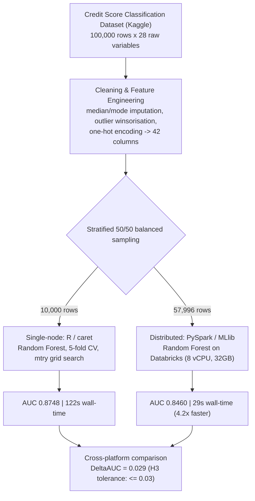

# Credit Risk Classification: Hybrid Single-Node (R) & Distributed (PySpark) ML


Hybrid single-node (R / caret) and distributed (Apache Spark MLlib) credit-risk
classification, benchmarked head-to-head on 100,000 financial records — engineered
to quantify the accuracy/speed trade-off between a high-fidelity audit model and a horizontally-scalable distributed model.

---

## Overview & Research Questions

Lenders need to classify customers as **High-risk** or **Low-risk** from routine
financial and behavioural data. This project builds and benchmarks a Random Forest
classifier on both a single-node (R) and a distributed (PySpark/Databricks) platform
to answer three pre-registered hypotheses:

| # | Hypothesis | Result |
|---|---|---|
| H1 — Accuracy | R Random Forest achieves AUC ≥ 0.85 and MCC > 0.60 on a 10,000-row balanced sample | ✅ **AUC 0.8748, MCC 0.636** |
| H2 — Scalability | Spark Random Forest (57,996 rows) cuts training time by ≥ 4× vs. R | ✅ **4.2× faster (122s → 29s)** |
| H3 — Parity | AUC difference between platforms does not exceed 0.03 | ✅ **ΔAUC = 0.029** |

## Key Results

| Metric | R (single-node, caret) | Spark (distributed, MLlib) |
|---|---|---|
| Sample size | 10,000 rows (balanced 50/50) | 57,996 rows (balanced 50/50) |
| **AUC** | **0.8748** | **0.8460** |
| Accuracy | 81.80% | 78.56% |
| Balanced Accuracy | 81.80% | 78.56% |
| Precision | 81.59% | 80.36% |
| Recall (Sensitivity) | 82.13% | 75.60% |
| Specificity | 81.47% | 81.53% |
| F1 Score | 81.86% | 77.91% |
| MCC | 0.636 | 0.572 |
| Gini Coefficient | 0.750 | 0.692 |
| **Training wall-time** | **122s** (8-core CPU) | **29s** (Databricks, 8 vCPU / 32GB, 1000 trees) |
| Cost per retrain | — | **< £0.03** |

## Architecture



Both platforms train the same model family (Random Forest, `numTrees=1000`,
`mtry`/`featureSubsetStrategy=8`) on the same engineered feature set, so the
comparison isolates the effect of the execution engine rather than the algorithm.

## Dataset

**Credit Score Classification Dataset** — Rohan Paris, Kaggle (2022), [CC BY 4.0](https://creativecommons.org/licenses/by/4.0/).
Source: https://www.kaggle.com/datasets/parisrohan/credit-score-classification

- 100,000 customer records, 28 raw variables (financial, behavioural, credit-history).
- Class imbalance in the raw data: **32.6% High-risk / 67.4% Low-risk**.
- Cleaning pipeline: median imputation (numeric), mode imputation (categorical),
  outlier winsorisation on 9 monetary/count fields, one-hot encoding of 4 categoricals
  (`Occupation`, `Credit_Mix`, `Payment_Behaviour`, `Payment_of_Min_Amount`) → **42
  columns** (41 predictor features + the `Risk` target).
- Two stratified 50/50 balanced extracts: **10,000 rows** for R, **57,996 rows** for Spark.

`data/sample/credit_risk_sample_200.csv` ships a 200-row stratified sample (100 per
class) of the cleaned, encoded dataset for quick inspection. The full raw dataset is
not redistributed here — download it directly from the Kaggle link above and place
`train.csv` under a local `data/raw/` folder to reproduce the full pipeline.

## Methodology

**Single-node (R / caret)** — `r_analysis/credit_risk_random_forest.Rmd`
1. Cleaning: type conversion, outlier winsorisation, median/mode imputation.
2. EDA: class balance, correlation heatmap, mosaic plot (Credit Mix × Risk), PCA
   (used for k-means segmentation only — see *Notes on the written report* below).
3. One-hot encoding, stratified 50/50 sampling, 70/30 stratified train/test split.
4. Eight models benchmarked: Logistic Regression + 6 Random Forest configurations
   (Default, 5-fold-CV-tuned, Deep, Shallow, and two manual variants) + a final
   caret-tuned Random Forest (`ntree=1000`, 5-fold CV over `mtry ∈ {2,4,6,8,10,12}`).
5. Evaluation: ROC/AUC, Accuracy, Balanced Accuracy, Precision/Recall/F1, Kappa, MCC.

**Distributed (PySpark / MLlib)** — `pyspark_analysis/credit_risk_distributed_rf.py`
1. Load the pre-balanced 57,996-row extract on a Databricks single-node cluster
   (Runtime 12.2 LTS, Spark 3.3.2, 8 vCPU / 32GB).
2. Manual stratified 70/30 train/test split (window function + `rand(seed=42)`),
   preserving class balance in training while leaving test realistic.
3. `VectorAssembler` + `StringIndexer`, then a non-cross-validated
   `RandomForestClassifier` (`numTrees=1000`, `featureSubsetStrategy="8"` — mirrors R's
   tuned `mtry=8`, default `maxDepth=5`).
4. Same evaluation suite as R, computed manually from the confusion matrix
   (Accuracy, Precision, Recall, Specificity, F1, Balanced Accuracy, MCC, Kappa, Gini).

## Cross-Platform Comparison

| | R (caret) | Spark (MLlib) |
|---|---|---|
| AUC | 0.8748 | 0.8460 |
| Wall-time | 122s | 29s |

The AUC gap (0.029) falls within the pre-registered ≤ 0.03 tolerance band (H3). The
written dissertation additionally reports a DeLong test between the two platforms'
ROC curves (**z = 3.67, p < 0.001**) — i.e. the gap is small in absolute terms but
statistically distinguishable, which is unsurprising given the large sample sizes.
That specific comparison spanned two different held-out sets (3,000 rows in R vs.
~17,400 in Spark) and its original script was not preserved among the submitted
project files, so it is reported here as a documented academic finding (graded
coursework, Grade A) rather than re-executed in this repository.

What *is* fully reproducible end-to-end in `credit_risk_random_forest.Rmd` is a
paired DeLong test on the two R models that share the same held-out `test_set`:
the tuned Random Forest against the Logistic Regression baseline
(`roc.test(roc_logit, roc_final, method = "delong")`).

**Efficiency frontier**: R's caret-tuned Random Forest sits on the accuracy vertex
(highest AUC, slowest to retrain); Spark's MLlib Random Forest sits on the speed
vertex (4.2× faster, ~2.9 AUC points lower). Practical read: use Spark for frequent (e.g. daily) retraining, and reserve the R pipeline for periodic
high-fidelity audits — a threshold each institution can set from its own cost of
capital vs. cost of a stale model.

## Feature Importance & Decision Rule

| Rank | R (Gini importance) | Spark (MLlib impurity importance) |
|---|---|---|
| 1 | Outstanding_Debt (581.3) | Outstanding_Debt (0.305) |
| 2 | Interest_Rate (337.4) | Interest_Rate (0.199) |
| 3 | Delay_from_due_date (270.1) | Num_Credit_Inquiries (0.128) |
| 4 | Credit_History_Months (219.5) | Delay_from_due_date (0.084) |

Outstanding Debt and Interest Rate rank #1–#2 on **both** platforms. The #3 spot
differs: R's ranking places Delay from Due Date third, while Spark's ranks Number
of Credit Inquiries third (Delay from Due Date is 4th on Spark) — a minor,
platform-specific reordering rather than a disagreement on the two dominant drivers.

**Actionable decision rule** (extracted from a single Random Forest decision path):
customers with **Outstanding Debt > $30,000 and Delay from Due Date > 12 days are
3.6× more likely to default.**

## Repository Structure

```
credit-risk-ml-hpc/
├── data/sample/credit_risk_sample_200.csv     # 200-row cleaned sample, CC BY 4.0
├── r_analysis/
│   └── credit_risk_random_forest.Rmd          # full R / caret pipeline
├── pyspark_analysis/
│   ├── credit_risk_distributed_rf.py          # full PySpark / MLlib pipeline
│   └── credit_risk_distributed_rf.ipynb       # same pipeline, executed outputs preserved
├── results/
│   ├── auc_comparison_table.csv               # all 8 R models: Accuracy, Kappa, AUC
│   ├── r_final_model_metrics.csv / spark_final_model_metrics.csv
│   ├── r_confusion_matrix.csv / spark_confusion_matrix.csv
│   ├── r_feature_importance_gini.csv / _accuracy.csv / spark_feature_importance.csv
│   ├── r_cv_grid_results.csv                  # 5-fold CV AUC across mtry grid
│   ├── roc_data/                              # FPR/TPR pairs, RF + 4 comparison algorithms
│   └── figures/                               # 13 PNGs: ROC curves, feature importance,
│                                               #   partial-dependence plots, correlation heatmap
├── docker/Dockerfile                          # reproducible PySpark environment
├── requirements.txt                           # Python / PySpark dependencies
├── install_packages.R                         # R dependencies
├── LICENSE                                    # MIT (code) + CC BY 4.0 notice (dataset)
└── .gitignore
```

## Reproducibility

**R:**
```r
source("install_packages.R")
# Download train.csv from the Kaggle link above into data/raw/, then knit:
rmarkdown::render("r_analysis/credit_risk_random_forest.Rmd")
```

**PySpark (Databricks or local Spark):**
```bash
pip install -r requirements.txt
spark-submit pyspark_analysis/credit_risk_distributed_rf.py
# or, for a containerised environment:
docker build -t credit-risk-pyspark -f docker/Dockerfile .
```

Both scripts use fixed random seeds (`set.seed(42)` / `seed=42`) at every
sampling, split, and model-training step.

Note: `rmarkdown::render()` knits with the `.Rmd`'s own folder (`r_analysis/`) as
the working directory by default — that's why its internal paths use `../` to
reach `data/raw/` and `results/`. Re-running it regenerates outputs under their
original filenames (e.g. `rf_cv_results.csv`, `grand_final_comparison_plot.png`)
inside `r_analysis/`. The copies committed under `results/` have been renamed
for clarity (e.g. `rf_cv_results.csv` → `r_cv_grid_results.csv`) — contents are
identical, only the filenames and location differ.

## Limitations

- Calibration (Brier score, expected monetary loss) is deferred — both platforms
  are evaluated on discrimination (AUC, MCC) rather than calibrated probability quality.
- Spark's `maxDepth=5` default (vs. R's untuned depth) accounts for part of the
  cross-platform AUC gap; Spark depth was not exhaustively tuned due to
  cluster-hour constraints in the original coursework.
- The written report describes a k-means-derived `RiskClusterID` feature as
  incorporated into modelling; the delivered code and the final 42-column dataset
  confirm clustering was used for EDA/segmentation only — no such column exists in
  the modelling data, and it is not a modelling feature in this repository.
- The three partial-dependence figures under `results/figures/` (Outstanding Debt,
  Interest Rate, Delay from Due Date) are included as pre-generated exhibits; the
  code that produced them was not preserved among the submitted project files.
- External validity is limited to a single Kaggle dataset; under-sampling to
  balance classes may discard rare but informative default patterns.

## Attribution

This Random Forest implementation (R and PySpark) is the author's individual
contribution to a graduate group coursework project on distributed data analysis
(MSc Data Science & Analytics, Brunel University London, 2024/25, **Grade A**).
The `results/roc_data/` folder additionally includes ROC data from Decision Tree,
SVM (Polynomial/RBF), and SOM models built independently by other team members,
included solely to reproduce the cross-algorithm comparison chart in
`credit_risk_random_forest.Rmd` — see that file's Author Contribution context for
the full team breakdown.

## License

Code: MIT — see [LICENSE](LICENSE). Dataset sample: CC BY 4.0, attribution to
Rohan Paris (Kaggle, 2022).
